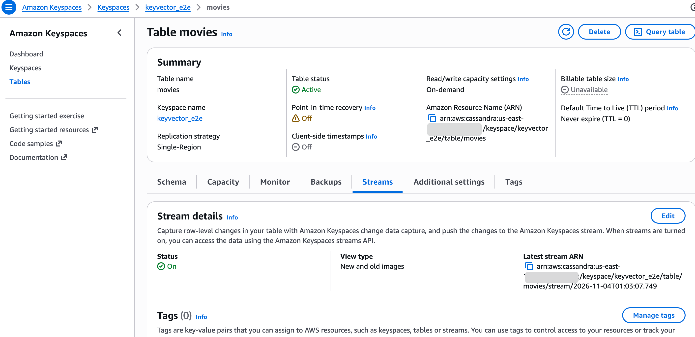
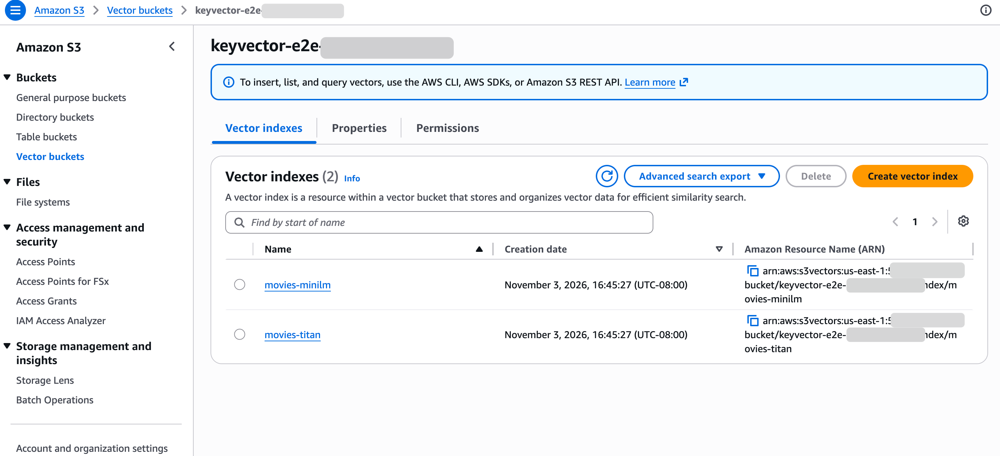
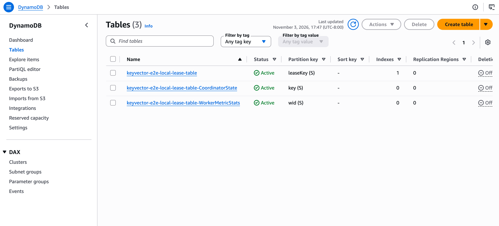
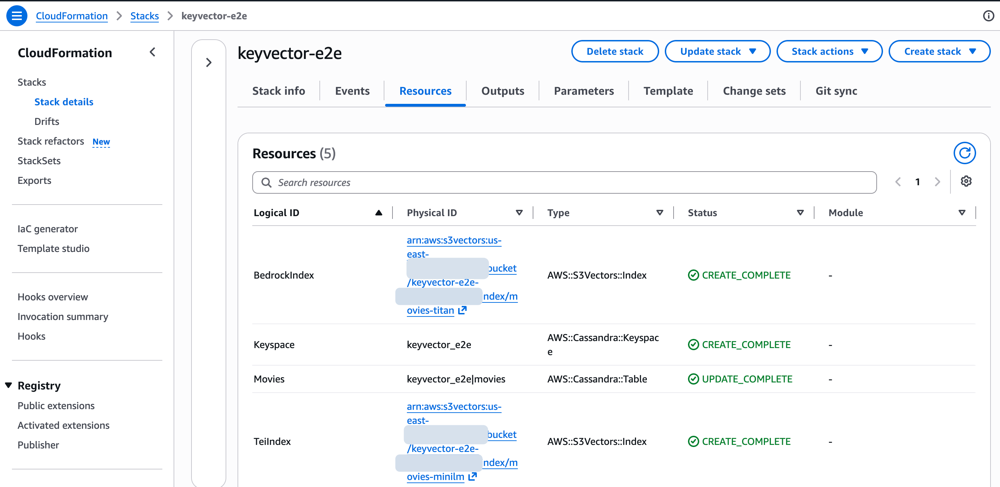

Keyvector runs in your AWS account, not ours. That's the point: your text never leaves the
account. It also means you should know exactly what it creates there before you install it. These
screenshots are from the end-to-end run on 3 November 2026, which used the
[in-process embedder](/notes/embeddings-without-a-model-server/) against a Keyspaces table of
movies. The account ID is blanked out.

## 1. Your table, with change data capture on



This is your table, not something Keyvector makes. The one change it needs is CDC, switched on with
the view type **New and old images**:

```sql
ALTER TABLE media.movies WITH cdc = true
  AND CUSTOM_PROPERTIES = {'cdc_specification': {'view_type': 'NEW_AND_OLD_IMAGES'}};
```

The new image is what Keyvector embeds, so it is required: `keyvector check` refuses a stream
that doesn't carry it. The old image is recommended. With it, Keyvector can tell an edit to the
embedded text from an edit to anything else, so a change to a view counter doesn't cost an
embedding. A stream's view type can't be changed later; you turn CDC off and on again.

## 2. The vector bucket and its index



Vectors live in Amazon S3 Vectors: a vector bucket, and an index in it for each table you sync.
This test bucket holds two indexes, one per model we tested: `movies-minilm` (384 dimensions) and
`movies-titan` (256). An index's dimension count is fixed when it is created, so changing models
means a new index and a backfill into it.

Each vector's key is the row's primary key, encoded so it can be decoded again
([one key per row](/notes/one-key-per-row/)). Beside it sit the metadata columns you chose, which
is what query filters run against.

## 3. KCL's lease tables, in DynamoDB



These three are the ones people don't expect. Keyvector reads the stream with the Kinesis Client
Library (KCL 3), through AWS's Keyspaces adapter, and KCL keeps its state in DynamoDB:

| Table | What KCL keeps there |
|---|---|
| `<application-name>-lease-table` | One row per stream shard: who owns it and how far it has read |
| `...-CoordinatorState` | Coordination between workers, when you run more than one |
| `...-WorkerMetricStats` | Each worker's load, used to balance shards |

The lease table is why a restart resumes where it stopped instead of starting over. Our test
stopped the connector, changed five rows and started it again: it applied exactly those five.

Two things to know:

- **The first start is slow.** KCL creates these tables and an index on the lease table (the
  `1` in the Indexes column), and takes no shards until the index is ready. Expect about twelve
  minutes once per application name. Later starts take seconds.
- **The name matters.** `application-name` in the config names the tables. Each synced table needs
  its own, and changing it starts the stream over from the beginning.

## 4. The stack



This is the test stack from the repository's [`e2e/`](https://github.com/keyvector/keyvector/tree/main/e2e)
kit, which makes its own keyspace and table to sync. In production you deploy
[`deploy/keyvector.yaml`](/guides/deploy/) against a table you already have, and it creates:

- the vector bucket and index (optional, if you already have them);
- an ECS cluster, a Fargate service and its task definition;
- a task role scoped to that one table and its stream, that one index, the lease tables for this
  stack's name, the dead-letter queue and, for Bedrock, that one model. The only actions open to
  every resource are the two that can't be narrowed: listing streams and writing metrics;
- an execution role, a security group and a log group;
- an SQS dead-letter queue for batches that keep failing.

## Removing it

Deleting the stack removes most of it, but not everything:

- **The vector bucket and index are kept** when you delete the production stack, on purpose: rebuilding
  an index means embedding every row again. Delete them in the S3 console when you are sure.
- **KCL's three lease tables aren't in the stack at all.** KCL creates them at runtime, so
  CloudFormation doesn't know they exist. Delete them in DynamoDB yourself. If you leave them,
  a later deploy with the same name resumes from the old positions, and they cost a little.
- **CDC stays on** for your table until you turn it off.

After our run we deleted the stack and the three tables, and the account was empty again: no
tables, no keyspace, no vector buckets.
